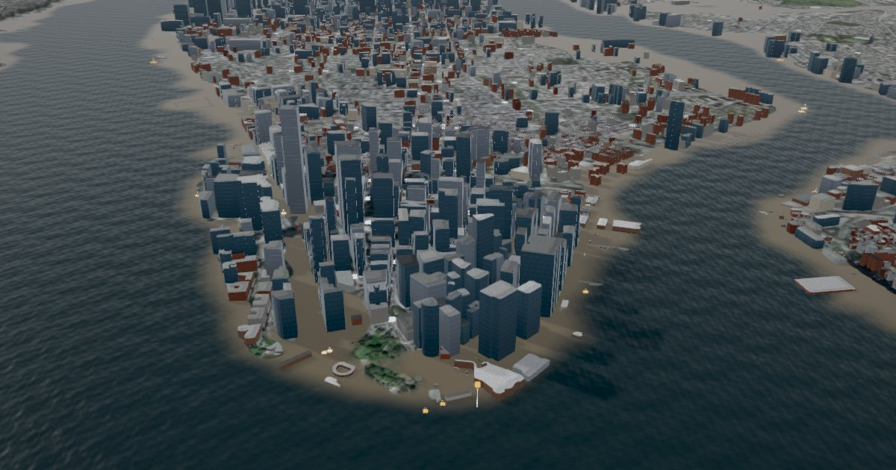

# FloodTwin NYC

A city-wide flood model of New York City that runs in the browser. It solves the shallow-water equations for all five boroughs on the graphics card, draws the city's 1.08 million buildings in 3D, and estimates damage and loss building by building.

**Open it:** https://alanhuang116.github.io/floodtwin-nyc/
**Methodology:** https://alanhuang116.github.io/floodtwin-nyc/methodology.html



## What It Does

- **Simulates** coastal surge, rainfall and compound floods over a 49 by 51 km domain with a local inertial shallow-water solver (Bates et al. 2010, de Almeida et al. 2012) written as WebGL 2 shaders: 1.56 million cells at 40 m, with 80 m (laptops) and 20 m (6.2 million cells) options. Buildings enter the flow as a sub-grid porosity.
- **Replays Hurricane Sandy** from four tide gauges (The Battery, Kings Point, Rockaway Inlet, Jamaica Bay at Inwood), blended through the harbour by distance through water, and scores the result live against 158 USGS high-water marks and the mapped 2012 inundation zone.
- **Tests scenarios:** Sandy with 2050s and 2100s sea level rise, a long nor'easter, the NYC DEP moderate and extreme stormwater scenarios, Hurricane Ida's rainfall and a compound storm, with surge, tide timing, sea level rise, rainfall, sewer capacity, roughness and grid size all editable.
- **Tests defences:** waterfront walls along any borough at a chosen crest, and barriers drawn on the map.
- **Estimates impact:** damage ratios from FloodVuln Global for the 730,000 buildings with National Structure Inventory values, totals by borough and for 262 neighborhoods, residents affected, subway stations and hospitals reached by water.
- **Shows it in 3D:** streamed building tiles with procedural facades and night lighting, every tower 40 m and over always on the skyline, the harbour's bridges with their towers, cables and night lights, rooftop water tanks, 652,000 street trees in late October colour, aerial imagery, a reflective water surface with waves, foam and flow tracers, and the storm's own clock for daylight and dark.
- **Runs on ordinary hardware:** the page picks its quality from the graphics card and adjusts the resolution to hold the frame rate.

## Running Locally

The site is static. Serve the `web` folder over HTTP and open it in a browser with WebGL 2:

```
cd web
python -m http.server 8000
```

Then open http://localhost:8000. GitHub Pages publishes `web/` through the workflow in `.github/workflows/pages.yml`.

## Repository Layout

| Path | Contents |
|---|---|
| `web/` | The application: `index.html`, `methodology.html`, `js/` (solver, scene, interface, chunk worker), `css/`, `data/` (prepared inputs, 46 MB, building tiles streamed on demand), `vendor/three/` (three.js r186) |
| `scripts/` | Data pipeline: download and prepare terrain, imagery, buildings, exposure, events, validation and the methodology page |
| `sim/solver.py` | Reference CPU implementation of the scheme |
| `tests/` | Headless scenario runs (validation), real-time QA and screenshots, chunk geometry tests |
| `data/processed/` | Validation runs (raw downloads in `data/raw/` are not in the repository) |

## Rebuilding the Data

The prepared files in `web/data/` are committed. To rebuild them, use Python 3.11 with `numpy`, `scipy`, `shapely`, `pyproj`, `pillow`, `tifffile` and `imagecodecs`, and run in order:

```
python scripts/fetch_dem.py          # USGS 3DEP 1/3 arc-second tiles
python scripts/fetch_imagery.py      # USGS National Map imagery tiles
python scripts/fetch_buildings.py nyc
python scripts/fetch_context.py      # OpenStreetMap buildings across the rivers
python scripts/fetch_bridges.py      # OpenStreetMap bridges
python scripts/fetch_nsi.py          # National Structure Inventory, five counties
python scripts/fetch_events.py       # gauges, Atlas 14, high-water marks
python scripts/fetch_vectors.py      # boundaries, Sandy zone, subway, hospitals, trees, FEMA
python scripts/build_terrain.py
python scripts/build_city.py
python scripts/build_bridges.py
python scripts/build_events.py
python scripts/build_meta.py
python tests/run_scenario.py sandy 40    # also 80 and 20
python scripts/build_validation.py
python scripts/build_methodology.py
```

## Tests

```
node --experimental-default-type=module tests/chunk_test.js   # roof and wall orientation, tile build times
python tests/run_scenario.py sandy 40                           # full Sandy replay in headless Edge
python tests/qa.py "qa&view=1&t=19440" 60000                    # real-time QA report
python tests/qa.py "qa&view=1&t=19440&clean" 60000 shot.png     # screenshot
```

## Data and Licences

US federal data (USGS 3DEP, the National Map imagery, NOAA CO-OPS and Atlas 14, USGS STN and gauges, FEMA NFHL, USACE NSI) are in the public domain. NYC building footprints, the Sandy Inundation Zone, the street tree census and boundaries are NYC Open Data. Buildings outside the city are © OpenStreetMap contributors under the Open Database Licence. three.js is MIT-licensed. Geist and Geist Mono are under the SIL Open Font Licence. Damage curves are from [FloodVuln Global](https://alanhuang116.github.io/floodvuln/).

Results are model estimates for illustration and screening. They are not a substitute for a site survey, an engineering assessment or an official flood map. See the [methodology](https://alanhuang116.github.io/floodtwin-nyc/methodology.html#limitations) for the assumptions and limitations.

Built by [Entanglix](https://entanglix.tech/).
